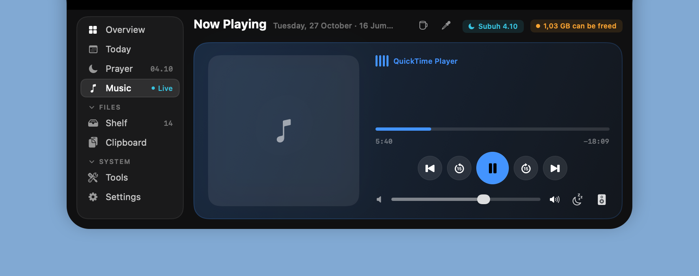

# Notchy

A small, native macOS app that turns the MacBook notch into a dashboard. Hover the notch (or press ⌥ Space) to open it.

Written in Swift and SwiftUI, with no third-party dependencies. The download is about 2 MB, and Notchy uses close to 0% CPU when idle.


| Today | Prayer times |
|---|---|
|  |  |



## Features

**Open panel**
- **Overview:** a health score plus CPU (with temperature), memory, network and disk, and a one-click cleanup of caches, logs and browser junk.
- **Today:** weather, your next calendar event with a **Join** button for 19 call services (Zoom, Meet, Teams, Webex, Slack, Discord, …), tasks with time reminders, and a focus timer.
- **Prayer times:** calculated on the Mac from your location (Kemenag, MWL, Umm al-Qura, Egypt, ISNA). Includes the Hijri date, a qibla compass, a countdown before each prayer, and a Ramadan mode with Imsak and the "Buka puasa" alert.
- **Shelf:** drop files on the notch to keep them at hand, then drag them out later. Drop on the right third to send by AirDrop. Screenshots land here automatically. You can also receive files from your phone over Wi-Fi with a QR code.
- **Clipboard:** text, image and file history with fuzzy search. Words inside images are searchable through on-device OCR. Pinned items are saved; passwords and concealed items are skipped.
- **Now playing:** controls for any player, including YouTube in the browser. Synced lyrics come from four free sources (LRCLIB, NetEase, QQ Music, Kugou), plus a sleep timer and output picker.
- **Tools:** an uninstaller that finds an app's leftovers, a large-file finder, and a camera mirror.
- **Header:** keep the Mac awake for a while, or pick a color anywhere on screen and copy its hex code.

**Closed notch**
- Lyrics while music plays, or a mini player.
- Volume and brightness levels.
- Download progress, and a note when a download finishes.
- Meeting countdown and prayer countdown.
- Short notices: charging, AirPods connected, Caps Lock, screenshots, focus timer, and more.


**Look**
- Layouts: Studio, Compact, Top tabs and Classic.
- Dark and light themes, 10 accent colors and 3 panel sizes.
- 3 notch shapes: drop, seamless and floating.
- SF Pro or Be Vietnam Pro.

## Install

1. Download `Notchy.dmg` from [Releases](../../releases) and drag Notchy into Applications.
2. The app is ad-hoc signed, not notarized. On first launch, right-click it and choose **Open**, or run:
   ```bash
   xattr -dr com.apple.quarantine /Applications/Notchy.app
   ```

Requires macOS 14 or later. Built as a universal binary for Apple silicon and Intel.

macOS asks for access only when a feature needs it:

| Access | Used for |
|---|---|
| Calendars | Up next, meeting reminders and Join |
| Location | Prayer times and weather (your location stays on the Mac) |
| Downloads, Desktop, Documents | Download progress, screenshots to the Shelf, large files |
| Automation | Reading and setting the volume |
| Camera | The mirror in Tools; nothing is recorded |
| Local network | Phone drop |

## Build

The build needs Xcode, which provides the macOS SDK used for the Now Playing helper.

```bash
./build.sh                   # → dist/Notchy.app and dist/Notchy.dmg
VERSION=1.1.0 ./build.sh     # set the version
```

## How it works

- **Now playing:** read through the system MediaRemote framework. A small helper is loaded by `/usr/bin/perl`, because recent macOS versions only answer MediaRemote requests from Apple-signed processes.
- **CPU temperature:** read through IOKit HID sensors. Brightness is read through DisplayServices. Both are loaded at run time, so missing symbols simply turn those features off.
- **Global shortcut:** registered through Carbon hot keys, so it needs no Accessibility permission.
- **Network services:** lyrics come from LRCLIB, NetEase, QQ Music and Kugou, with only the title and artist sent. Weather comes from Open-Meteo. None of them needs an API key, and there is no tracking or analytics.

## Credits

Ideas were studied from these open-source projects; Notchy's code is written from scratch:
NotchDrop, DynamicNotchKit, Stats, Maccy, KeyboardShortcuts, Pearcleaner, LyricsX, Boring.notch, Atoll and Hidden Bar.

The Be Vietnam Pro font is © The Be Vietnam Pro Project Authors and licensed under the [SIL Open Font License](Resources/Fonts/OFL.txt).
