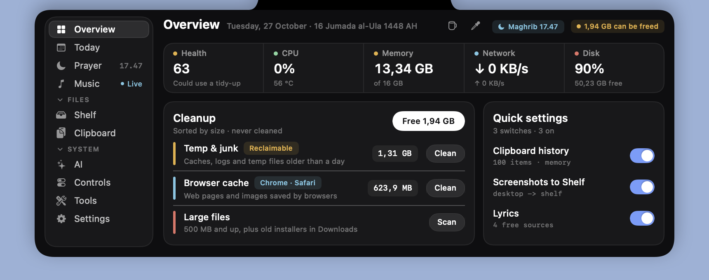
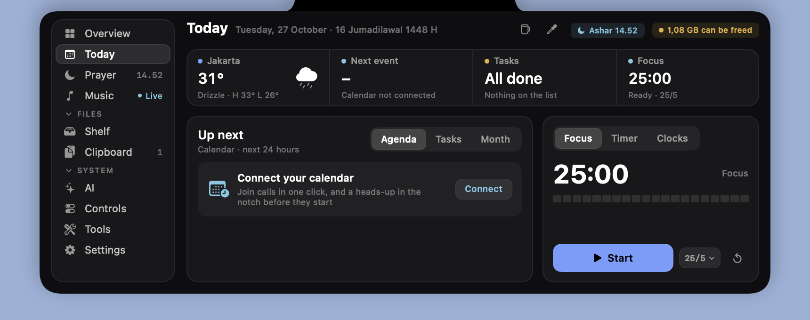
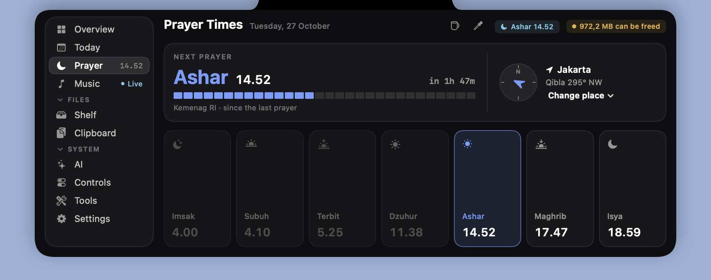
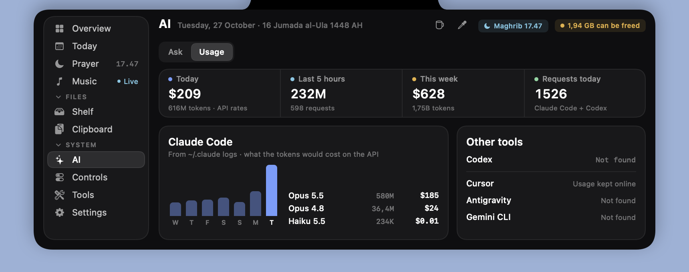
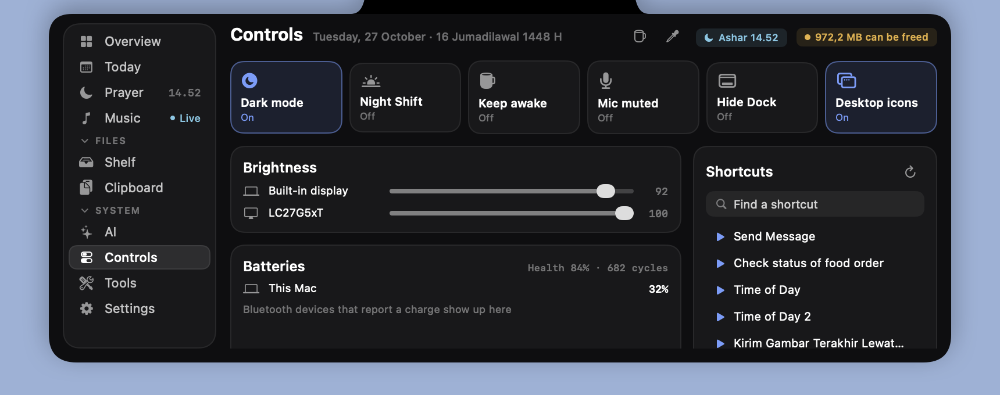
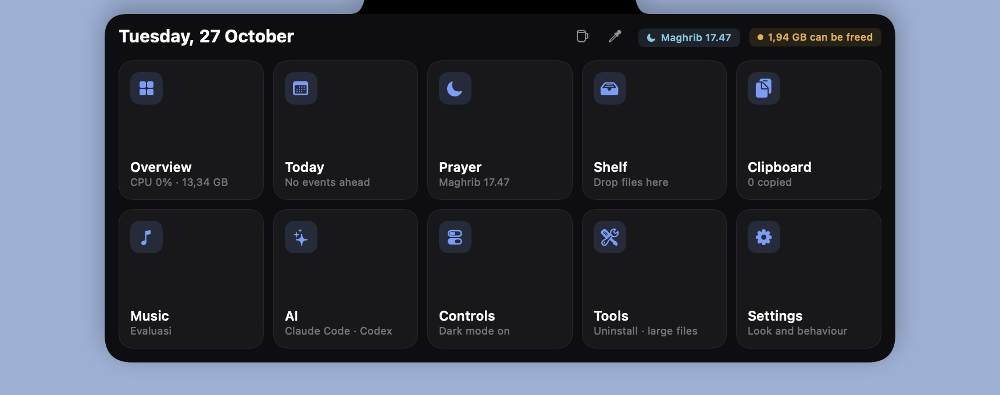
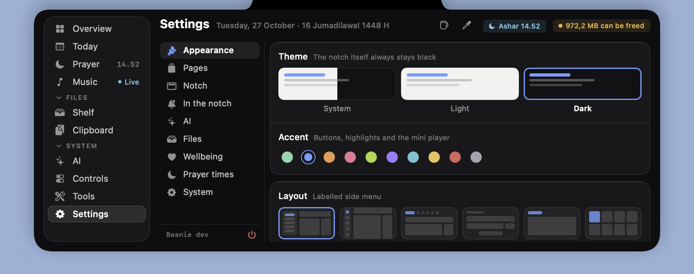
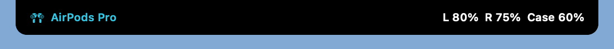
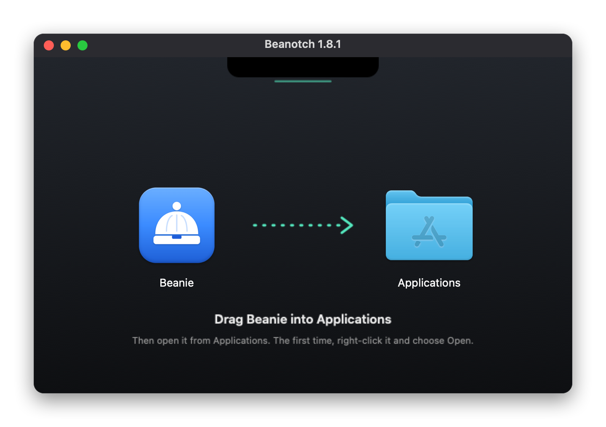

# Beanie

A small, native macOS app that turns the MacBook notch into a dashboard. Hover over the notch (or press ⌥ Space) to open it.

Beanie is written in Swift and SwiftUI with no third-party dependencies. The download is about 3.6 MB, and it uses close to 0% CPU when idle.



| Today | Prayer times |
|---|---|
|  |  |

| AI usage | Controls |
|---|---|
|  |  |

| Launcher layout | Settings |
|---|---|
|  |  |

## Features

### Open panel

- **Overview:**
  - A health score.
  - CPU (with temperature), memory, network and disk.
  - One-click cleanup of caches, logs and browser junk.
- **Today:**
  - Weather.
  - Your next calendar event, with a **Join** button for 19 call services (Zoom, Meet, Teams, Webex, Slack, Discord, …).
  - Tasks with time reminders.
  - A month view.
  - A focus timer, a countdown timer and world clocks.
- **Prayer times:**
  - Calculated on the Mac from your location, using the Kemenag, MWL, Umm al-Qura, Egypt or ISNA method.
  - The Hijri date and a qibla compass.
  - A countdown before each prayer.
  - A Ramadan mode with Imsak and the "Buka puasa" alert.
- **Shelf:**
  - Drop files on the notch to keep them at hand, then drag them out later.
  - Drop on the right third to send by AirDrop.
  - Screenshots land here automatically.
  - Receive files from your phone over Wi-Fi with a QR code.
- **Clipboard:**
  - Text, image and file history, with fuzzy search.
  - Words inside images are searchable, through on-device OCR.
  - Pinned items are saved; passwords and concealed items are skipped.
  - **Notes:** a scratchpad that saves as you type and can go to the Shelf as a text file.
- **Now playing:**
  - Controls for any player, including YouTube in the browser.
  - Synced lyrics from four free sources: LRCLIB, NetEase, QQ Music and Kugou.
  - A sleep timer and an output picker.
- **AI usage:**
  - **Claude Code**, read from its local logs: tokens and estimated API cost for today, the last 5 hours and the week, per model, with a 7-day chart.
  - **Codex**, read from its local logs: tokens and rate-limit windows.
  - Cursor, Antigravity and Gemini CLI are detected, but their usage is not shown yet (see below).
- **AI, on your Mac:**
  - **Ask:** one question at a time to Apple's on-device model (macOS 26+, offline and free), Claude Code, or a local Ollama model.
  - **Clipboard actions:** ✦ on copied text summarizes, translates (English ⇄ Indonesian), fixes grammar or explains it.
  - **Screenshot names:** new screenshots can be renamed after what they show ("invoice-oktober.png"), read and named on the Mac.
  - **Claude Code in the notch:** while Claude works the notch shows the project; it tells you when Claude is done or waiting, and permission requests appear in the panel with Allow and Deny. Switch it on in Settings › AI: Beanie adds hooks to `~/.claude/settings.json` (and removes them when switched off). If Beanie isn't running, Claude Code asks in the terminal as usual.
- **Controls:**
  - Dark mode, Night Shift, keep awake, mic mute, Dock hiding and desktop icons.
  - Brightness sliders for every screen, including external monitors over DDC.
  - Battery health and cycle count, and the charge of Bluetooth devices.
  - Your Apple Shortcuts, ready to run.
- **Tools:** an uninstaller that finds an app's leftovers, a large-file finder and a camera mirror.
- **Header:** keep the Mac awake for a while, or pick a color anywhere on screen and copy its hex code.

### Closed notch

| Lyrics | AirPods |
|---|---|
|  |  |

| Prayer countdown | Volume |
|---|---|
|  |  |

| Timer | Download |
|---|---|
|  |  |

| Messages |
|---|
|  |

- Lyrics or a mini player while music plays.
- Volume and brightness levels.
- Download progress.
- Timer, meeting and prayer countdowns.
- AirPods charge, for each bud and the case.
- **Messages:** when WhatsApp, Telegram, Slack, Discord, Messages, Mail, Teams, Signal or LINE gets a new unread badge in the Dock, the notch shows it. Click the notch to open the app. The header also keeps a count, with a menu that jumps into each app.
- Short notices: charging, Caps Lock, screenshots, finished downloads, Shortcuts results, updates.
- **Gestures:** swipe sideways over the notch to change songs; scroll up or down for volume.

### Look

- Six layouts:
  - **Studio**: a labelled side menu.
  - **Compact**: an icon rail.
  - **Top tabs**: tabs along the top.
  - **Classic**: a greeting and a dock.
  - **Minimal**: just the page; the title is the menu.
  - **Launcher**: opens on a grid of live tiles.
- Every page fits every layout and size, and scrolls when the panel is too short for it.
- **Pages:** switch off any page you don't use in Settings › Pages. Turning off Prayer also removes prayer times from the header and the notch, and the Hijri date.
- Dark and light themes, 10 accent colors and 3 panel sizes.
- Three notch shapes: drop, seamless and floating.
- Flat buttons that light up under the pointer, and segmented controls with a sliding thumb.
- Settings in sections, with visual pickers for the theme, layout and notch shape.
- SF Pro or Be Vietnam Pro.

## Install

1. Download `Beanotch.dmg` from [Releases](../../releases), open it, and drag Beanie into Applications.

   

2. The app is ad-hoc signed, not notarized. On first launch, right-click it and choose **Open**, or run:
   ```bash
   xattr -dr com.apple.quarantine /Applications/Beanie.app
   ```

Requires macOS 14 or later, as a universal binary for Apple silicon and Intel. Brightness control for external monitors works on Apple silicon only.


macOS asks for access only when a feature needs it:

| Access | Used for |
|---|---|
| Calendars | Up next, meeting reminders and Join |
| Location | Prayer times and weather (your location stays on the Mac) |
| Downloads, Desktop, Documents | Download progress, screenshots to the Shelf, large files |
| Automation | Volume, dark mode and Dock hiding (through System Events) |
| Camera | The mirror in Tools; nothing is recorded |
| Accessibility | Reading the unread badges on Dock icons (only the numbers, never the messages) |
| Local network | Phone drop |

## Build

The build needs Xcode, which provides the macOS SDK for the Now Playing helper.

```bash
./build.sh                   # → dist/Beanie.app and dist/Beanotch.dmg (laid out with dmgbuild, set up in .build/ on first run)
VERSION=1.2.0 ./build.sh     # set the version
```

Commit messages follow [Conventional Commits](https://www.conventionalcommits.org) and are checked by commitlint. Run `npm install` once to set up the hook.

## How it works

- **Now playing:** read through the system MediaRemote framework. A small helper is loaded by `/usr/bin/perl`, because recent macOS versions only answer MediaRemote requests from Apple-signed processes.
- **Hardware:**
  - CPU temperature comes from IOKit HID sensors.
  - Built-in brightness goes through DisplayServices, and Night Shift through CoreBrightness.
  - External monitors are reached over DDC/CI through IOAVService.
  - All of these are loaded at run time, so a missing symbol only switches that feature off.
- **AI usage:** Beanie reads the logs Claude Code and Codex already write (`~/.claude/projects`, `~/.codex/sessions`), and only the new lines on each pass. Costs are Anthropic API list prices for the same tokens, not what a subscription charges. Beanie never reads or sends sign-in tokens, which is why Cursor and Antigravity, which keep usage on their servers, are listed but not measured.
- **Messages:** read from the badges on Dock icons through Accessibility, every 2 seconds. Beanie only sees the count on the icon, so the app has to be in the Dock (running or kept there). macOS keeps message contents to itself, so there is no sender or text.
- **Global shortcut:** registered through Carbon hot keys, so it needs no Accessibility permission.
- **Network:**
  - Lyrics come from LRCLIB, NetEase, QQ Music and Kugou; only the title and artist are sent.
  - Weather comes from Open-Meteo.
  - Updates are checked against GitHub Releases.
  - None of these needs an API key, and there is no tracking or analytics.

## Credits

Ideas came from studying these open-source projects; Beanie's code is written from scratch:
NotchDrop, DynamicNotchKit, Stats, Maccy, KeyboardShortcuts, Pearcleaner, LyricsX, Boring.notch, Atoll, Hidden Bar, MeetingBar, MonitorControl and Itsycal.

The Be Vietnam Pro font is © The Be Vietnam Pro Project Authors and licensed under the [SIL Open Font License](Resources/Fonts/OFL.txt).
